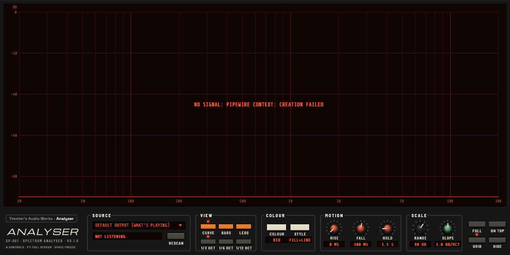

# TAW Analyser

**Timster's Audio Works – Analyser (SP-001) v0.2.0**: a stand-alone spectrum analyser for Windows and Linux, in the TAW look shared with the Library, Player and Equaliser (Spool or Porcelain, light or dark).



It's a desktop program written in Rust (egui for the panel), formerly the SP-10 that came with EQ Box. It doesn't need the Equaliser or anything else installed: on Windows the `.exe` can be copied anywhere by itself. **It only listens and never plays anything**, so it can't feed back.

## Download

From the [Releases page](https://github.com/TimsterAudio/TAW-Analyser/releases/latest):

- **Linux:** `taw-analyser-…-linux-x86_64.tar.gz`. Extract it and run `./taw-analyser`. It needs PipeWire 0.3.53 or newer (Ubuntu 24.04, Fedora 40, Arch or later).
- **Windows:** `taw-analyser-…-windows-x86_64.zip`. Extract it and run `taw-analyser.exe`.

## What it does

- **Source:** the default output (whatever is playing), any other output, or an input such as a microphone. Outputs are heard through PipeWire's monitors on Linux and WASAPI loopback on Windows.
- **View:** a curve, bars or LED columns, at 1/3, 1/6 or 1/12 octave.
- **Colour** and **Style:** red, amber, green, ice, white, rainbow or heat; filled, line or both. The same schemes as the Equaliser's analyser.
- **Motion:** **Rise** and **Fall** times, and **Hold** for peak markers (off at 0).
- **Scale:** the **Range** shown below 0 dBFS (40 to 120 dB), and the **Slope** in dB per octave (3 makes pink noise read flat).
- **For any screen:** the window resizes freely. **H** hides the controls (double-click the display to bring them back), **F11** or **Full** goes full screen, **On top** keeps it above other windows, **Grid** shows or hides the scale, and **Space** freezes the display.

## Building

```sh
cargo build --release
```

Linux needs the PipeWire and ALSA headers: `libpipewire-0.3-dev libspa-0.2-dev libasound2-dev libclang-dev pkg-config` on Debian and Ubuntu. Windows needs nothing extra.

`packaging/linux/taw-analyser.desktop` is a launcher entry you can copy to `~/.local/share/applications/`.
